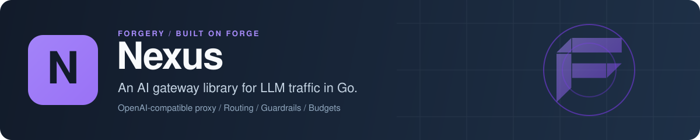

<p align="center">
  
</p>

# Nexus: AI gateway and LLM proxy library for Go

Nexus is an open-source AI gateway library for Go. You put it in front of OpenAI, Anthropic, Gemini, Bedrock, Ollama and 25 other LLM providers, and every request goes through one pipeline: provider routing, model aliases, response caching, PII and prompt-injection guardrails, multi-tenant gateway keys, rate limits and monthly budgets, and usage tracking with exact cost. It serves an OpenAI-compatible API with SSE, NDJSON and WebSocket streaming, and it runs inside your own process, either standalone or as a [Forge](https://github.com/xraph/forge) extension.

[](https://go.dev/dl/) [](https://github.com/xraph/nexus/actions/workflows/ci.yml) [](https://pkg.go.dev/github.com/xraph/nexus) [](https://github.com/xraph/nexus/stargazers)

[Documentation](https://www.xraph.com/docs/nexus) · [Quick start](#quick-start) · [Features](#why-nexus) · [Providers](#providers) · [Pipeline](#the-request-pipeline) · [Forge](#use-it-with-forge) · [Examples](#examples) · [FAQ](#faq)

## Quick start

You need [Go 1.26 or later](https://go.dev/dl/) and an OpenAI API key. Each provider is its own Go module, so you add the root and the providers you call:

```bash
go get github.com/xraph/nexus@latest
go get github.com/xraph/nexus/providers/openai@latest
```

Save this as `main.go`:

```go
package main

import (
	"context"
	"log"
	"net/http"
	"os"
	"time"

	"github.com/xraph/nexus"
	"github.com/xraph/nexus/model"
	"github.com/xraph/nexus/providers/openai"
	"github.com/xraph/nexus/proxy"
)

func main() {
	ctx := context.Background()

	gw := nexus.New(
		nexus.WithProvider(openai.New(os.Getenv("OPENAI_API_KEY"))),
		nexus.WithAlias("fast", model.AliasTarget{Provider: "openai", Model: "gpt-4o-mini"}),
		// An open gateway, for trying it out locally. Remove this line
		// before anyone else can reach the port.
		nexus.WithRequireAPIKey(false),
	)
	if err := gw.Initialize(ctx); err != nil {
		log.Fatal(err)
	}
	defer gw.Shutdown(ctx)

	srv := &http.Server{
		Addr:              ":8080",
		Handler:           proxy.New(gw.Engine()),
		ReadHeaderTimeout: 10 * time.Second,
	}
	log.Println("Nexus listening on http://localhost:8080/v1")
	if err := srv.ListenAndServe(); err != nil {
		log.Println(err)
	}
}
```

Run it, then call it the way you'd call OpenAI:

```bash
OPENAI_API_KEY=sk-... go run .

curl http://localhost:8080/v1/chat/completions \
  -H 'Content-Type: application/json' \
  -d '{"model": "fast", "messages": [{"role": "user", "content": "Say hello"}]}'
```

`fast` is an alias, so the alias stage rewrites the model to `gpt-4o-mini` before the provider call. Any OpenAI SDK works too: set its base URL to `http://localhost:8080/v1`. Add `"stream": true` to the body and you get server-sent events in the `chat.completion.chunk` shape the SDKs expect.

The gateway keeps tenants, keys and usage in memory here, so they're gone when you stop it. Drop the `WithRequireAPIKey(false)` line and every `/v1` request needs an `nxs_` gateway key. The [proxy example](_examples/proxy/) creates a tenant and a key at startup, and [Persistence](#tenants-keys-and-persistence) shows where they go in production.

## Why Nexus?

You probably started by calling one provider's SDK straight from your handlers. That works until you need a second provider, a budget per customer or a record of who spent what, and then each of your services grows its own half-finished copy of the same routing, retry and metering code. Nexus is that layer as a Go library. You compose a `nexus.Gateway` from options and mount it on your own server, so you don't deploy anything new.

| You need | Nexus gives you |
| --- | --- |
| Several LLM providers behind one API | 30 released provider modules, an OpenAI-compatible HTTP API, and `Engine` for calls from Go |
| Control over which provider answers | Priority, cost-optimized, latency-optimized, round-robin and weighted routing, plus model aliases with per-tenant overrides |
| Fewer paid calls for repeated prompts | Response caching in memory or Redis, and record-and-replay caching for streamed responses |
| Safer prompts and outputs | Guardrails for PII (block, redact or warn), prompt injection, blocklists and custom regex |
| Customers with their own limits | Tenants, `nxs_` gateway keys with scopes, RPM and TPM windows, daily request caps and monthly budgets in exact USD |
| Streaming that fits your client | OpenAI-style SSE, Nexus SSE with named events, NDJSON, and a bidirectional WebSocket at `/v1/realtime` |
| A record of every request | Usage records with tokens, latency and cost, OpenTelemetry spans and GenAI metrics, and 19 lifecycle hooks for audit, webhooks and metrics |
| Data in your own database | PostgreSQL, SQLite and MongoDB stores through [Grove](https://github.com/xraph/grove), or in memory |

## Providers

Each provider lives in `providers/<name>` as its own module, so you only download what you import. They all implement `provider.Provider`, and most of the OpenAI-compatible ones wrap `providers/openai`.

| Group | Providers |
| --- | --- |
| Frontier APIs | `openai`, `anthropic`, `gemini`, `mistral`, `cohere`, `xai`, `deepseek`, `ai21` |
| Cloud platforms | `azureopenai`, `bedrock`, `vertex`, `nvidia` |
| Fast inference hosts | `groq`, `cerebras`, `sambanova`, `fireworks`, `together`, `deepinfra`, `hyperbolic`, `lepton`, `nebius`, `novita`, `anyscale`, `perplexity`, `openrouter` |
| Embeddings only | `voyageai`, `jinaai` |
| Local models | `ollama`, `lmstudio` |
| Anything else that speaks OpenAI | `opencompat`, with `opencompat.New(name, baseURL, apiKey)` |

`geminilive` and `openairealtime` (realtime audio) are in the repo too, but they haven't been tagged yet, so you can't `go get` them at a released version.

Register as many as you like. If you don't pick a router, Nexus uses the priority strategy, which goes by the order you registered providers in:

```go
gw := nexus.New(
	nexus.WithProvider(openai.New(os.Getenv("OPENAI_API_KEY"))),
	nexus.WithProvider(anthropic.New(os.Getenv("ANTHROPIC_API_KEY"))),
	nexus.WithRouter(strategies.NewCostOptimized()),
)
```

| Strategy | Constructor |
| --- | --- |
| Priority (default) | `strategies.NewPriority(order ...string)` |
| Cost-optimized | `strategies.NewCostOptimized()` |
| Latency-optimized | `strategies.NewLatencyOptimized()` |
| Round-robin | `strategies.NewRoundRobin()` |
| Weighted | `strategies.NewWeighted(map[string]float64{"openai": 0.7, "anthropic": 0.3})` |

## Call it from Go

You don't need HTTP at all. `gw.Engine()` sends requests through the same pipeline, guardrails and cache included:

```go
gw := nexus.New(
	nexus.WithProvider(openai.New(os.Getenv("OPENAI_API_KEY"))),
	nexus.WithCache(stores.NewMemory()),
	nexus.WithGuard(guards.NewPII(guard.ActionRedact)),
	nexus.WithGuard(guards.NewInjection()),
)
if err := gw.Initialize(ctx); err != nil {
	log.Fatal(err)
}
defer gw.Shutdown(ctx)

resp, err := gw.Engine().Complete(ctx, &provider.CompletionRequest{
	Model:     "gpt-4o-mini",
	Messages:  []provider.Message{{Role: "user", Content: "What is the capital of France?"}},
	MaxTokens: 100,
})
if err != nil {
	log.Fatal(err)
}
fmt.Println(resp.Choices[0].Message.Content, resp.Usage.TotalTokens)
```

`Engine` also has `CompleteStream`, `Embed` and `ListModels`. The [streaming example](_examples/streaming/) reads a stream three ways: as an iterator, over a channel, and through an accumulator.

## The request pipeline

Every request runs through the same chain of middleware, whether it came in over HTTP, over gRPC or through `Engine`. Stages are sorted by priority, lower first. A stage you didn't configure isn't in the chain at all, so you only pay for what you turn on:

| Priority | Stage | When it's there |
| --- | --- | --- |
| 5 | Request ID | always |
| 10 | Telemetry: OpenTelemetry span and request metrics, then your own tracer | always; the tracer with `WithTracer` |
| 15 | Usage recording | unless usage is off |
| 20 | Timeout | when the timeout is above zero (30s by default) |
| 30, 40 | Identity, then tenant status and key scopes | always |
| 50 | Quota: token cap, daily requests, budget, RPM, TPM | always, with the default usage service |
| 60 | Stream lifecycle hooks | always, short-circuits for non-streams |
| 150 | Input guardrails | `WithGuard` |
| 200 | Transforms | `WithTransforms` |
| 250, 260 | Alias resolution, then the tenant's model allow and block lists | aliases only with `WithAlias` |
| 280 | Cache | `WithCache` or `WithStreamCache` |
| 340 | Retry | when retries are above zero (2 by default) |
| 350 | Provider call | always, last |

`WithMiddleware` adds your own stage at whatever priority it reports. A stage that turns a request away returns `*nexus.RefusalError`, with an HTTP status, a code and, when a limit applies, `Limit` and `RetryAfter`.

Transforms live in `transform`: `NewSystemPrompt`, `NewRAG` for retrieval context, `NewAnonymizer` and `NewAnonymizerOutput`, and `NewNormalizer`. Put them in a `transform.NewRegistry()` and pass it with `WithTransforms`.

## Tenants, keys and persistence

A tenant carries a quota (`RPM`, `TPM`, `DailyRequests`, `MonthlyBudgetUSD`, `MaxTokensPerReq`, and stream caps) and its own allowed or blocked models. Gateway keys belong to a tenant, look like `nxs_` plus 64 hex characters, carry scopes, and are stored as hashes. You create them through `gw.Tenants()` and `gw.Keys()` in Go, or over the admin API once you have an admin key.

If you don't pass a store, everything lives in memory and is gone when the process exits. For anything you want to keep, pass a Grove-backed store:

| Backend | Package |
| --- | --- |
| PostgreSQL | `store/postgres`, `postgres.New(db *grove.DB)` |
| SQLite | `store/sqlite`, `sqlite.New(db *grove.DB)` |
| MongoDB | `store/mongo`, `mongo.New(db *grove.DB)` |
| Memory | `store.NewMemory()` |

Hand it to the gateway with `nexus.WithDatabase(s)` and call `s.Migrate()` once at startup. Money is `money.USD`, an exact decimal, so compare amounts with `Equal` and never with `==`.

## HTTP API

Two packages serve HTTP, and both are plain `net/http` handlers you can mount on any router:

| Package | Routes |
| --- | --- |
| `proxy`, `proxy.New(gw.Engine())` | `POST /v1/chat/completions`, `POST /v1/embeddings`, `GET /v1/models`, `GET /v1/models/{model}`, `GET /health`, `/v1/realtime` |
| `api`, `api.New(gw).Handler()` | the same `/v1` routes plus `/admin/tenants`, `/admin/keys`, `/admin/usage` and `/admin/providers` |

The `/admin` routes always need a key with the `admin` scope, whatever `RequireAPIKey` says. Streaming responses pick their wire format from `?stream_format=` (`sse`, `nexus`, `ndjson`) or the `Accept` header. `grpcsrv` is a separate module that serves completions over gRPC server-streaming, and the [gRPC example](_examples/grpc/) shows it with key auth.

## Use it with Forge

The `extension` package turns Nexus into a Forge extension. It reads config under `extensions.nexus` (or `nexus`), builds a store from a `*grove.DB` in the container when it finds one, migrates it on start, and registers `*nexus.Gateway` for the rest of your app.

```go
import (
	"github.com/xraph/forge"
	nexusext "github.com/xraph/nexus/extension"
	"github.com/xraph/nexus/providers/openai"
)

app := forge.NewApp(forge.AppConfig{
	Name:        "ai-gateway",
	HTTPAddress: ":8080",
	Extensions: []forge.Extension{
		nexusext.New(
			nexusext.WithProvider(openai.New(os.Getenv("OPENAI_API_KEY"))),
		),
	},
})
```

Once the app has started, resolve the gateway with `forge.Inject[*nexus.Gateway](app.Container())`. The extension doesn't register HTTP routes itself today, so serve `proxy.New(gw.Engine())` or `api.New(gw).Handler()` where you want the API to live.

```yaml
extensions:
  nexus:
    default_timeout: 30s
    default_max_retries: 2
    global_rate_limit: 1000   # requests per minute, 0 means unlimited
    require_api_key: true
    enable_usage: true
    enable_cache: false
    grove_database: ""        # a named grove.DB; empty uses the default one
    disable_migrate: false
    log_level: info
```

The admin API needs a first admin key, and no route can create one. Set `NEXUS_BOOTSTRAP_ADMIN_KEY` (or `bootstrap_admin_key`, though a secret in a committed YAML file stays there forever) to `nxs_` followed by the output of `openssl rand -hex 32`. On start the extension stores it under a tenant with the slug `operator`, once, and never logs it.

| Option | What it does |
| --- | --- |
| `WithProvider(p)` | Registers an LLM provider |
| `WithDatabase(s)` | Uses this store, unless the container has a `*grove.DB` (see below) |
| `WithGroveDatabase(name)` | Resolves a named `*grove.DB` from the container |
| `WithGatewayOption(opt)` | Passes any `nexus.Option` through to the gateway |
| `WithStreamCache(sc, opts)`, `WithStreamLifecycleConfig(cfg)` | Stream caching and hook tuning |
| `WithConfig(cfg)`, `WithRequireConfig(true)` | Sets config in code, or fails `Register` when the YAML key is missing |
| `WithDisableMigrate()` | Leaves migrations to you |

`WithDatabase` doesn't stop Grove discovery. `Register` still looks for a `*grove.DB` (the named one from `WithGroveDatabase`, or the default one) and, when it finds it, builds a store from it after your options, so the container's store wins over the one you passed. If you want your own store, keep a `*grove.DB` out of the container.

The [Forge extension guide](https://www.xraph.com/docs/nexus/guides/forge-extension) covers how YAML and code options merge.

## Documentation

| Topic | Read |
| --- | --- |
| First gateway | [Getting started](https://www.xraph.com/docs/nexus/getting-started), [architecture](https://www.xraph.com/docs/nexus/architecture) |
| Providers, routing and aliases | [Providers](https://www.xraph.com/docs/nexus/core/providers), [routing](https://www.xraph.com/docs/nexus/core/routing), [aliases](https://www.xraph.com/docs/nexus/core/aliases) |
| Caching, guardrails and transforms | [Caching](https://www.xraph.com/docs/nexus/core/caching), [guardrails](https://www.xraph.com/docs/nexus/core/guardrails), [transforms](https://www.xraph.com/docs/nexus/core/transforms) |
| Tenants and keys | [Multi-tenancy](https://www.xraph.com/docs/nexus/concepts/multi-tenancy), [identity](https://www.xraph.com/docs/nexus/concepts/identity) |
| Streaming and the HTTP API | [Streaming guide](https://www.xraph.com/docs/nexus/guides/streaming), [HTTP API](https://www.xraph.com/docs/nexus/api-reference/http-api), [streaming API](https://www.xraph.com/docs/nexus/api-reference/streaming-api) |
| Storage | [PostgreSQL](https://www.xraph.com/docs/nexus/stores/postgres), [SQLite](https://www.xraph.com/docs/nexus/stores/sqlite), [MongoDB](https://www.xraph.com/docs/nexus/stores/mongo) |
| Hooks, audit and tracing | [Plugins](https://www.xraph.com/docs/nexus/infrastructure/plugins), [audit](https://www.xraph.com/docs/nexus/infrastructure/audit), [observability](https://www.xraph.com/docs/nexus/infrastructure/observability) |

The Go API is on [pkg.go.dev](https://pkg.go.dev/github.com/xraph/nexus), and each provider has its own page there under `github.com/xraph/nexus/providers/<name>`.

## Examples

| Example | What it shows |
| --- | --- |
| [Standalone](_examples/standalone/) | A gateway with routing, cache, guardrails and an alias, called from Go |
| [Proxy](_examples/proxy/) | The OpenAI-compatible proxy with SSE, NDJSON, WebSocket, stream caching and a gateway key |
| [Streaming](_examples/streaming/) | Iterator, channel and accumulator stream APIs |
| [Multi-tenant](_examples/multi-tenant/) | Tenants, gateway keys and usage tracking |
| [gRPC](_examples/grpc/) | Server-streaming completions over gRPC |
| [Realtime](_examples/realtime/), [Live](_examples/live/) | OpenAI Realtime and Gemini Live sessions |
| [Forge](_examples/forge/) | Building the Forge extension |

Most of them read `OPENAI_API_KEY`. The ones without a `go.mod` sit in the root module under `_examples`, which `go build ./...` skips, so run them by path: `go run ./_examples/proxy`.

## FAQ

### Can I use Nexus as an OpenAI-compatible proxy?

Yes. `proxy.New(gw.Engine())` serves `/v1/chat/completions`, `/v1/embeddings` and `/v1/models` in OpenAI's request and response shapes. Point an OpenAI SDK's base URL at it and pass an `nxs_` gateway key as the API key.

### How do I set a per-customer budget or rate limit for LLM calls?

Create a tenant with a `Quota`: `RPM`, `TPM`, `DailyRequests`, `MonthlyBudgetUSD` and `MaxTokensPerReq`. Give the customer a key under that tenant. The quota stage refuses a request over any limit with a `RefusalError` that carries `RetryAfter` when waiting would help.

### Does Nexus fall back to another provider when one fails?

The retry stage retries a failed call twice by default, with backoff (`WithMaxRetries` changes the count). Which provider answers is up to the routing strategy, and the priority strategy tries providers in registration order. A `fallback` package with a circuit breaker exists, but the default pipeline doesn't use it yet.

### Can I use Nexus without Forge?

Yes. The root module, `proxy`, `api` and every provider work with plain `net/http`. The `extension` package is the only part that imports Forge.

### Do I need an API key to run the tests?

No. Provider tests run against mock HTTP servers from `testutil`. Postgres and MongoDB store tests only run when you set `NEXUS_TEST_POSTGRES_DSN` or `NEXUS_TEST_MONGO_URI`.

## Contributing

Issues and focused pull requests are welcome. Open an [issue](https://github.com/xraph/nexus/issues) first for anything large.

```bash
git clone https://github.com/xraph/nexus.git
cd nexus
make test     # go test ./... in every module
make lint     # golangci-lint in every module
make fmt      # gofmt and goimports
```

The repo is many Go modules (the root, `config`, `grpcsrv` and one per provider), tied together by the committed `go.work`. Run a command with `GOWORK=off` when you want to see how one module resolves on its own. Skip `make run`, `make dev` and `make build-bin`, which point at a `cmd/nexus` that doesn't exist. [AGENTS.md](AGENTS.md) has the full command list, the lint rules and how releases are cut. Commits follow [Conventional Commits](https://www.conventionalcommits.org/) with a scope, as in `fix(sqlite): ...`.

## License

MIT. See [LICENSE](LICENSE).

Nexus is part of the [forgery stack](https://github.com/xraph/forge#the-forgery-stack) built on [Forge](https://github.com/xraph/forge), by [Rex Raphael](https://github.com/juicycleff) and [contributors](https://github.com/xraph/nexus/graphs/contributors).
